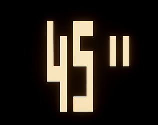

  

  

    

  
  
  
  

---

## 👋 Sobre mí

¡Buenas! Soy **Izan**, tengo **17 años** y actualmente estudio **DAW (Desarrollo de Aplicaciones Web)**. Me estoy formando en programación, desarrollo frontend y gestión de bases de datos con el objetivo de construir aplicaciones web completas y bien estructuradas.

- 🎓 **Formación (DAW):** Aprendiendo maquetación web, diseño de interfaces y bases de datos relacionales.
- 🧩 **Base de programación:** Actualmente aprendiendo los fundamentos de la **Programación Orientada a Objetos (POO)** y lógica algorítmica en **C#**.
- 🚀 **Enfoque:** Seguir ampliando mi stack web y aplicar buenas prácticas de código en cada proyecto.

---

## 🛠️ Lenguajes y tecnologías que estoy aprendiendo

- **Frontend (HTML & CSS):** Estructura semántica, maquetación y diseño visual de páginas web.
- **Bases de Datos (SQL):** Creación de tablas, relaciones y consultas estructuradas.
- **Programación (C#):** Estructuras de datos, manejo de matrices y fundamentos de POO.

---

## 💻 Prácticas y ejercicios de programación

Repositorios donde subo ejercicios de lógica, algoritmos y programación orientada a objetos:

  
  

---

## 📊 Estadísticas de GitHub

  
  

---

## 🎮 Más sobre mí: Aficiones y proyectos personales

Fuera del desarrollo web, llevo alrededor de **1 año creando videojuegos en 3D** por mi cuenta como hobby, habiendo publicado varios títulos en [Itch.io](https://titodev.itch.io), y subo muy de vez en cuando vídeos sobre ello a mi canal de YouTube [@tito_dev](https://www.youtube.com/@tito_dev).

<table>
  <tr>
    <td width="32%" align="center">
      
    </td>
    <td width="68%" valign="middle">
      <strong>⏱️ Proyecto personal destacado — <a href="https://titodev.itch.io/45-seconds" target="_blank">45 Seconds</a></strong>
      

        Un juego en el que hay que <strong>encontrar al impostor en 5 días que duran 45 segundos</strong> cada uno. Lo desarrollé para la <a href="https://itch.io/jam/unpolished-jam-2/rate/3866242" target="_blank">Unpolished Jam #2</a> (donde quedó en 1º lugar) y está disponible junto a mis otros juegos en <a href="https://titodev.itch.io" target="_blank">titodev.itch.io</a>.
      

    </td>
  </tr>
</table>

 

  
  

